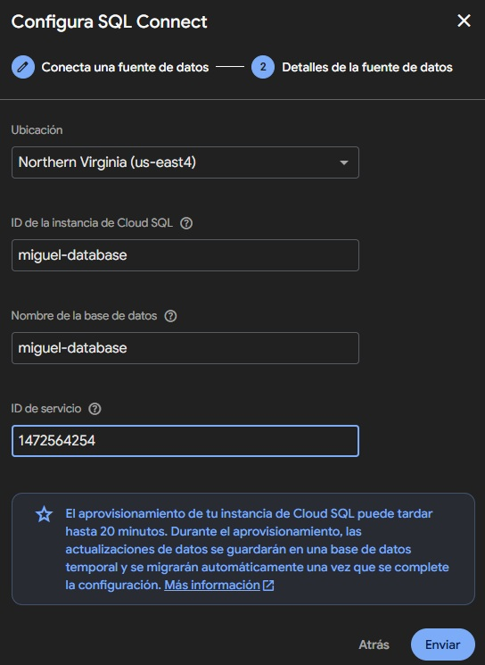
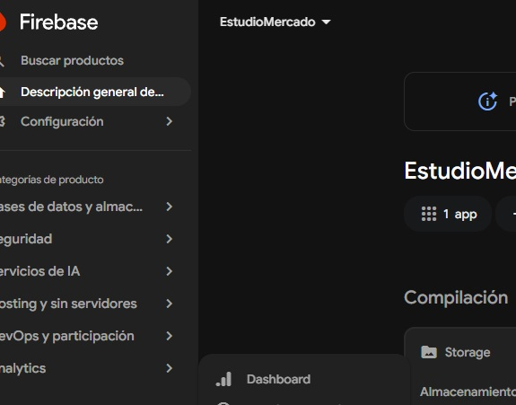
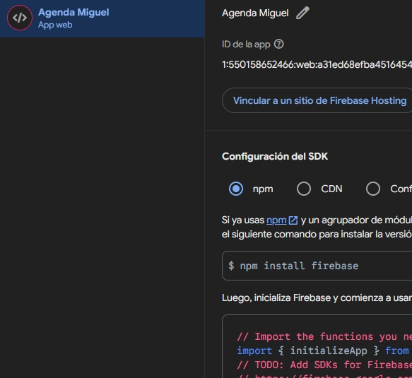

# Agenda Miguel

## 1. URL pública

La versión publicada de Agenda Miguel puede visitarse en:

[https://agenda-miguel-59b68.web.app](https://agenda-miguel-59b68.web.app)

La aplicación permite acceder a la agenda desde un navegador y administrar los contactos registrados.

## 2. Capturas de pantalla

Las siguientes imágenes forman parte de la evidencia del proyecto y están incluidas directamente en este repositorio:

### Conexión de la base de datos



### Interfaz de Firebase



### Proyecto creado correctamente



## 3. Tecnologías utilizadas

- PHP 8 para la lógica del servidor y las páginas de la agenda.
- MySQL o MariaDB para usuarios y contactos.
- Apache mediante XAMPP para ejecutar el proyecto localmente.
- HTML5 y CSS3 para la estructura y presentación de la interfaz.
- PDO y consultas preparadas para trabajar con MySQL de forma segura.
- `password_hash()` y `password_verify()` para proteger las contraseñas.
- Firebase Hosting para publicar la versión web disponible en línea.

## 4. Instrucciones para instalar el proyecto localmente

1. Instale XAMPP en Windows desde el sitio oficial de Apache Friends.
2. Copie la carpeta `App_Miguel_Oñate` dentro de `C:\xampp\htdocs\`.
3. Abra el panel de XAMPP y encienda los servicios **Apache** y **MySQL**.
4. Entre a `http://localhost/phpmyadmin` y cree una base de datos llamada `agenda_miguel`.
5. Seleccione esa base de datos, pulse **Importar** y cargue `basesDatos/agenda_miguel.sql`.
6. Abra `backend/.env` y compruebe la conexión local:

   ```ini
   DB_HOST=127.0.0.1
   DB_PORT=3306
   DB_NAME=agenda_miguel
   DB_USER=root
   DB_PASSWORD=
   ```

7. Guarde los cambios y abra `http://localhost/App_Miguel_Oñate/index.php`.
8. Registre una cuenta, inicie sesión y use `contactos.php` para crear, consultar, editar o eliminar contactos.

No abra los archivos `.php` directamente desde el Explorador de Windows; deben ejecutarse mediante Apache.

## 5. Detalle de las mejoras respecto a la versión anterior

- Se incorporó búsqueda de contactos por nombre, correo electrónico o ciudad.
- Se agregó ordenamiento por nombre y ciudad, en sentido ascendente o descendente.
- Se organizaron las operaciones del servidor dentro de `backend/` y se corrigieron las rutas de los formularios.
- Se reforzó el control de acceso: cada consulta utiliza la sesión y el `id_usuario` para mostrar únicamente los contactos de su propietario.
- Se mejoró la protección de credenciales con contraseñas cifradas, validaciones de formularios y consultas PDO preparadas.
